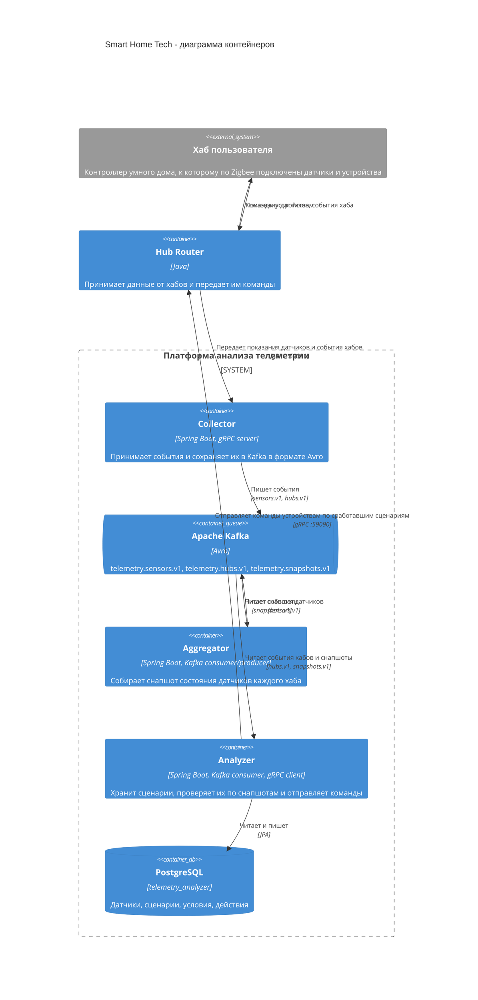

# Smart Home Tech

Платформа для сбора и анализа телеметрии умного дома. Хабы пользователей присылают показания датчиков и события конфигурации (добавлен датчик, создан сценарий). Платформа собирает актуальное состояние каждого дома, проверяет пользовательские сценарии и отправляет хабам команды для устройств

## Стек

Java 21 · Spring Boot 3.3 · Maven (multi-module) · Apache Kafka · Apache Avro · gRPC + Protobuf · PostgreSQL 16 · Spring Data JPA · Flyway · Docker Compose

## Архитектура

### Общая схема


### C4


## Сервисы

### Hub Router

Готовый сервис (`hub-router/scripts/hub-router.jar`). Принимает данные от хабов по закрытому бинарному протоколу, переводит их в gRPC-вызовы Collector и исполняет команды, которые присылает Analyzer. В локальных тестах эмулирует хабы и проверяет результат работы всей цепочки

### Collector

Точка входа данных в платформу

- Вход: gRPC на порту `59091`, два вызова - прием показаний датчиков и прием событий хабов (датчик добавлен или удален, сценарий создан или удален)
- Выход: `telemetry.sensors.v1` (события датчиков) и `telemetry.hubs.v1` (события хабов и сценариев), ключ сообщения - `hubId`
- Отдельный обработчик на каждый тип события преобразует Protobuf в Avro
- Подтверждает прием только после записи в Kafka (см. [ADR-001](#adr-001-момент-подтверждения-приема-события-в-collector))

### Aggregator

Превращает поток отдельных показаний в актуальное состояние каждого дома

- Вход: `telemetry.sensors.v1`
- Выход: `telemetry.snapshots.v1` - снапшот хаба с последними показаниями всех его датчиков
- Снапшоты хранятся в памяти. Новая версия снапшота отправляется только если событие его изменило (устаревшие и повторяющиеся показания отбрасываются)
- Смещения фиксируются вручную, после отправки снапшотов

### Analyzer

Делает дом «умным»: проверяет сценарии пользователя и отдает команды устройствам

- Вход: `telemetry.hubs.v1` и `telemetry.snapshots.v1` - два независимых консьюмера в разных группах и в разных потоках
- Выход: команды устройствам по gRPC в Hub Router (порт `59090`) - какому датчику или устройству, что сделать и по какому сценарию
- События хабов (добавление и удаление датчиков и сценариев) сохраняются в PostgreSQL. Обработка идемпотентная, повторное получение события безопасно
- Снапшоты: для хаба загружаются его сценарии. Если все условия сценария выполнены, по каждому действию отправляется команда. Смещение фиксируется после каждого снапшота, чтобы минимизировать повторную отправку команд
- Схема БД создается миграциями Flyway при старте

## Запуск

```bash
docker compose up -d                 # Kafka :9092 (+ топики) и PostgreSQL :5432
mvn clean install -DskipTests
java -jar telemetry/collector/target/collector-1.0-SNAPSHOT.jar
java -jar telemetry/aggregator/target/aggregator-1.0-SNAPSHOT.jar
java -jar telemetry/analyzer/target/analyzer-1.0-SNAPSHOT.jar
cd hub-router && ./run-tests.sh      # тесты Hub Router для текущей ветки
```

Настройки сервисов - в `src/main/resources/application.yml` каждого модуля

## ADR

### ADR-001. Момент подтверждения приема события в Collector

Контекст: сервис Collector принимает запросы от Hub Router по gRPC и сохраняет их в Kafka. Нужно решить, в какой момент отвечать отправителю 200, чтобы событие гарантированно оказалось в Kafka

Требования:
- гарантия доставки at-least-once от отправителя до Kafka
- пиковая нагрузка до 2 000 событий в секунду (оценка: 10 000 хабов, в среднем событие раз в 5 секунд от каждого)
- время ответа при работающей Kafka не больше 50 мс для 99% запросов
- если Kafka недоступна, отправитель получает ошибку не позже чем через 10 секунд, чтобы повторить запрос, а не ждать бесконечно
- отправитель умеет повторять запрос, если получил ошибку

Варианты:
1. Fire and forget - положить событие в буфер producer'а и сразу ответить успехом, а ошибку отправки только залогировать
2. Асинхронная отправка с принудительным сбросом буфера - отправить событие, дождаться, пока весь буфер producer'а уйдет брокеру, и ответить успехом
3. Синхронная отправка - дождаться подтверждения брокера, что именно это сообщение записано, и только потом ответить. При ошибке вернуть ошибку отправителю
4. Outbox - сохранить событие в локальную БД или журнал, сразу ответить, а в Kafka отправлять отдельным процессом

Сравнение:

| # | Плюсы | Минусы                                                                                                                                                                                            |
|---|---|---------------------------------------------------------------------------------------------------------------------------------------------------------------------------------------------------|
| 1 | Минимальная задержка, максимальная пропускная способность | Событие теряется при падении сервиса или недоступности Kafka, отправитель об этом не узнает (at-most-once)                                                                                        |
| 2 | Сообщение гарантированно отправлено к моменту ответа | Сброс буфера не сообщает об ошибках - при неудачной записи отправитель все равно получит успех. Ждет весь общий буфер, включая сообщения других запросов                                          |
| 3 | At-least-once: ошибка доходит до отправителя, и он повторяет запрос. Простая реализация | Сервис ждет, пока отправка каждого сообщения подтвердится брокером. Поток запроса занят все это время | 
| 4 | Гарантия без ожидания Kafka, быстрый ответ | Отдельное хранилище и процесс досылки - избыточная сложность для сервиса-сборщика                                                                                                                 |

Решение: вариант 3 - синхронная отправка с ожиданием подтверждения брокера

Настройки producer'а под это решение: `acks=all`, `enable.idempotence=true`, `linger.ms=1`, `delivery.timeout.ms=7000`, `request.timeout.ms=3000`, `max.block.ms=3000`

Ответ занимает порядка 5-20 мс (ожидание пачки 1 мс, сетевой круг до брокера и запись на реплики), что укладывается в 50 мс, а сообщения параллельных запросов уходят брокеру общими пачками, поэтому 2 000 событий в секунду выдерживает один экземпляр сервиса. Если Kafka недоступна, таймауты ограничивают ожидание 10 секундами (3 с на `max.block.ms` и 7 с на `delivery.timeout.ms`), после чего отправитель получает ошибку
